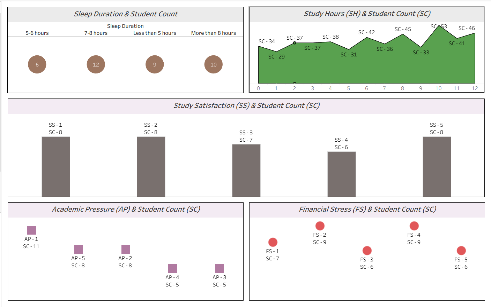

# 🎓 Student Depression Analysis | SQL Server + Tableau

An exploratory data analysis project that examines student depression-related data and explores its relationship with academic pressure, study satisfaction, sleep duration, study hours, and financial stress using **Microsoft SQL Server and Tableau Public**.

## 📊 Dashboard Preview



*Interactive dashboard built using Tableau Public.*

## 🎯 Project Objectives

- Explore student depression-related data using SQL.
- Standardize categorical values and create meaningful age groups.
- Analyze distributions across academic and lifestyle factors.
- Visualize student counts across key variables using Tableau.
- Practice SQL-based data preparation and dashboard development.

## 🛠️ Tech Stack

| Tool | Purpose |
|---|---|
| Microsoft SQL Server | Data transformation and exploratory analysis |
| SQL Server Management Studio (SSMS) | Writing and executing SQL queries |
| Tableau Public | Data visualization and dashboard development |
| Microsoft Excel / CSV | Dataset inspection and data exchange |

## 📁 Project Structure

```text
Student-Depression-Analysis/
│
├── README.md
├── SQLQuery.sql
├── Clean_Dataset_Students_Depression.csv
│
└── images/
    └── student-depression-dashboard.png
```

## 🗄️ Dataset Overview

The dataset used in this project contains **502 records and 13 columns**.

| Feature | Description |
|---|---|
| Gender | Student gender |
| Age | Student age |
| Academic_Pressure | Reported academic pressure |
| Study_Satisfaction | Reported study satisfaction |
| Sleep_Duration | Student sleep-duration category |
| Dietary_Habits | Reported dietary habits |
| Have_you_ever_had_suicidal_thoughts | Self-reported history of suicidal thoughts |
| Study_Hours | Daily study hours |
| Financial_Stress | Reported financial stress |
| Family_History_of_Mental_Illness | Indicator of family history |
| Depression | Depression label |
| Age_Group | Derived age category |
| Index_Column | Sequential record identifier |

*Note: These variables describe reported characteristics and categories. They should not be interpreted as clinical diagnoses.*

## 🧹 SQL Data Preparation

The SQL script demonstrates the following operations:

- **Gender standardization:** Converted `Male` to `M` and `Female` to `F`.
- **Data quality checks:** Checked for NULL and blank values in the gender column.
- **Age analysis:** Retrieved age distributions and minimum/maximum ages.
- **Age-group creation:** Added an `Age_Group` column using SQL `CASE` expressions:
  - `A1`: Ages 18–24
  - `A2`: Ages 25–30
  - `A3`: All other ages
- **Exploratory analysis:** Used `GROUP BY` and `COUNT()` to examine distributions across academic pressure, study satisfaction, sleep duration, dietary habits, study hours, financial stress, family history, suicidal thoughts, and depression.
- **Record identification:** Added an auto-incrementing `Index_Column`.
- **Depression-label transformation:** Converted binary depression values into `No` and `Yes` after changing the column's data type.

## 📈 Tableau Dashboard

The dashboard contains five visualizations:

### 1. Sleep Duration & Student Count
Compares student counts across sleep-duration categories.

### 2. Study Hours & Student Count
Visualizes the distribution of students across study-hour values.

### 3. Study Satisfaction & Student Count
Compares student counts across study-satisfaction levels.

### 4. Academic Pressure & Student Count
Shows how student counts are distributed across academic-pressure levels.

### 5. Financial Stress & Student Count
Displays student counts across financial-stress levels.

Together, these visualizations provide an overview of the distribution of students across selected academic and lifestyle factors.

## 🔍 Key Analytical Questions

This project explores questions such as:

- How are students distributed across sleep-duration categories?
- How many students fall into each study-satisfaction level?
- What is the distribution of academic-pressure levels?
- How are students distributed across study hours?
- How many students report each financial-stress level?
- How are depression labels distributed in the dataset?

## 🚀 How to Reproduce the Project

1. Clone or download this repository.
2. Open SQL Server Management Studio.
3. Execute `SQLQuery.sql` against a suitable SQL Server instance.
4. Ensure the source dataset is available and the database and table names match your environment.
5. Open Tableau Public.
6. Connect to `Clean_Dataset_Students_Depression.csv` using the **Text File** connector.
7. Recreate the worksheets and dashboard, or open your Tableau workbook if you include it in the repository.

**Important:** The SQL script creates a database and alters the source table. Review it before execution, and avoid rerunning the script blindly against an already-modified table.

## ⚠️ Limitations

- The dataset is observational and does not establish causation.
- Student counts alone do not demonstrate that a particular factor causes depression.
- The dashboard is exploratory and is not intended for clinical diagnosis or individual risk assessment.
- The CSV used in Tableau should match the version of the dataset analyzed in SQL Server.

## 📚 What I Learned

- Writing SQL queries for exploratory data analysis.
- Standardizing categorical values and creating derived columns.
- Using aggregation, grouping, conditional logic, and schema inspection in SQL Server.
- Connecting CSV data to Tableau Public.
- Designing a multi-chart dashboard to communicate distributions clearly.

## 👨‍💻 Author

**Arman Shikalgar**

Aspiring Data Engineer | Python Developer | Data Analytics

---

⭐ If you find this project useful, consider giving the repository a star.
